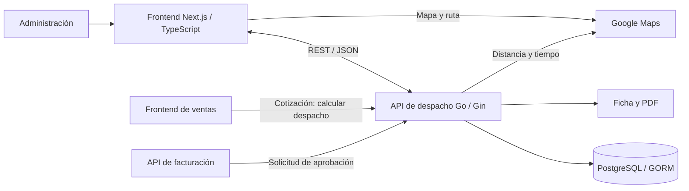

# ConstrUTEM: diagrama de la célula de despacho

Revisión e implementación: 17 de octubre de 2026.

## Alcance

Se consultaron 320 archivos de código, configuración y documentación de los diez repositorios públicos encontrados en la organización. Se recorrieron sus dependencias, funciones y llamadas HTTP, con lectura detallada de la implementación de despacho, mapas, datos, acceso y conexiones entre células. Los recursos binarios, imágenes, archivos lock y módulos de terceros no forman parte de esta revisión de código.

Esto es una revisión estática orientada a representar la arquitectura. No se ejecutaron los servicios externos ni se verificaron sus credenciales, bases de datos o infraestructura desplegada. El inventario de archivos consultados está en [construtem-despacho-fuentes.json](./construtem-despacho-fuentes.json).

| Repositorio | Rama revisada | Archivos consultados |
| --- | --- | --- |
| Construtem/frontend-inventario | develop | 43 |
| Construtem/frontend-facturacion | develop | 49 |
| Construtem/backend-facturacion | develop | 34 |
| Construtem/backend-ventas | develop | 41 |
| Construtem/infra | main | 3 |
| Construtem/frontend-ventas | develop | 61 |
| Construtem/Mockups | main | 1 |
| Construtem/frontend-login | develop | 20 |
| Construtem/backend-inventario | develop | 53 |
| Construtem/backend-login | develop | 15 |

## Contexto aportado por el autor

Proyecto académico de todo el curso que simuló una empresa real. Tres células con PO asignados y cuatro desarrolladores por célula: dos frontend y dos backend. Además, participaron dos DevOps, dos QA, un ingeniero de seguridad, un technical leader, un scrum master y un product leader.

El autor participó en frontend de la célula de despacho y colaboró en backend. La tarjeta refleja esa participación sin atribuirle la totalidad del sistema ni el trabajo de otras especialidades.

## Arquitectura confirmada en el código

Despacho comparte repositorios con inventario: `frontend-inventario` y `backend-inventario`. Forma parte de un sistema de servicios por dominios con comunicación HTTP y acceso a PostgreSQL. Dentro del backend de inventario se distingue una organización por rutas, handlers, controladores y modelos con GORM. No se encontró un bus de eventos que justifique representar este flujo como dirigido por eventos.

### Frontend de despacho

- La lista consulta `GET /api/despachos`; implementa carga, errores, búsqueda, filtros, paginación y modal de productos.
- Consulta productos por despacho y permite acceder al PDF generado por el backend.
- La vista de ruta consulta los despachos y selecciona el solicitado mediante `despachoId`.
- El mapa usa `@react-google-maps/api`, DirectionsService y DirectionsRenderer. La ruta entre origen y destino se calcula en el navegador.

Fuentes: [lista](https://github.com/Construtem/frontend-inventario/blob/develop/src/app/admin/despacho/page.tsx), [vista de ruta](https://github.com/Construtem/frontend-inventario/blob/develop/src/app/admin/despacho/ruta/page.tsx), [componente del mapa](https://github.com/Construtem/frontend-inventario/blob/develop/src/app/admin/despacho/ruta/MapView/GoogleMapComponent.tsx).

### Backend de despacho

- Gin registra las rutas REST; los handlers validan entradas y llaman a los controladores.
- GORM consulta cotizaciones, productos, sucursales, direcciones, tipos de camión y despachos en PostgreSQL.
- El cálculo separa productos en unidades, agrupa por peso y volumen, selecciona capacidad y camión, consulta distancia y calcula costo de envío.
- La aprobación por cotización cambia el estado y descuenta stock mediante una transacción.
- El backend genera fichas y PDF. El diagrama los llama documentos de despacho y no certificación tributaria.
- El backend consulta Google Maps para distancia y duración. Existen implementaciones de Directions y Distance Matrix.

Fuentes: [rutas](https://github.com/Construtem/backend-inventario/blob/develop/api/Routes/register.go), [handlers](https://github.com/Construtem/backend-inventario/blob/develop/api/Handlers/HandlerDespacho.go), [controlador](https://github.com/Construtem/backend-inventario/blob/develop/api/Controllers/ControllerDespacho.go), [PDF](https://github.com/Construtem/backend-inventario/blob/develop/api/Controllers/pdf.go), [servicio de distancias](https://github.com/Construtem/backend-inventario/blob/develop/services/google_maps.go).

### Integración entre células

- El frontend de ventas solicita el cálculo al servicio de inventario/despacho, enviando cotización y dirección.
- Facturación contiene una llamada HTTP para aprobar los despachos de una cotización; el controlador de despacho cambia estado y ajusta stock.
- El ecosistema incluye un acceso compartido mediante Firebase y validación de rol. No se presenta como una garantía de protección de todos los endpoints.

Fuentes: [cliente de ventas](https://github.com/Construtem/frontend-ventas/blob/develop/src/services/apiServices.ts), [envío desde facturación](https://github.com/Construtem/backend-facturacion/blob/develop/handlers/Enviar_datos_despacho.go), [callback de acceso](https://github.com/Construtem/frontend-inventario/blob/develop/src/app/auth/callback/AuthCallbackClient.tsx).

### Estado que se representa

La etiqueta del panel es **Proyecto académico**. Docker Compose, GitHub Actions y GKE se describen como infraestructura configurada.

La revisión detectó detalles que impiden asegurar un funcionamiento completo en producción sin ejecución: el layout de administración tiene modo de desarrollo activo; algunas vistas ofrecen datos de ejemplo al fallar la API; y la llamada de facturación agrega `/despachos/cambiar-estado` mientras el servidor registra `/api/despachos/cambiar-estado`, por lo que la base configurada o el proxy deben resolver ese prefijo. No se modificaron estos repositorios externos.

## Implementación en el portafolio

- Nueva variante tipada `dispatch-service` en RepositoryFlow.
- Nueva función ConstrutemDispatchFlow dentro de ProjectFlowDiagram.tsx, reutilizando FlowNode, FlowIcon y el marco de repositorios.
- Flujo principal: administración → frontend → API → datos y documentos.
- Franja de lógica de negocio: capacidad de camiones, peso, volumen y costo por distancia.
- Tres conexiones explícitas: Google Maps, ventas y facturación.
- Descripción y tecnologías de ConstrUTEM ajustadas al alcance de despacho y a la participación indicada por el autor.
- Estilos propios bajo `.dispatch-flow-*`; las conexiones conservan el celeste del panel compartido.
- Disposición vertical en móvil. Se conserva la selección de diagramas existente, el espacio de Próximamente y la reserva de altura de páginas y colecciones.

## Verificación

- ESLint: aprobado.
- TypeScript y build Vite: aprobados.
- Navegador: diagrama visible en escritorio y móvil, sin desbordamiento horizontal.
- Altura de Proyectos estable en escritorio: 1561.49 px en Publicados, Repositorios 01 y Repositorios 02.
- Posición de la paginación de repositorios estable al alternar páginas: 3159.22 px desde el inicio del documento en la vista de escritorio probada.
- Ambos diagramas de publicados, Ruta 5, Beat y Próximamente se conservan.
- Carga completa del navegador comprobada sin errores nuevos.

