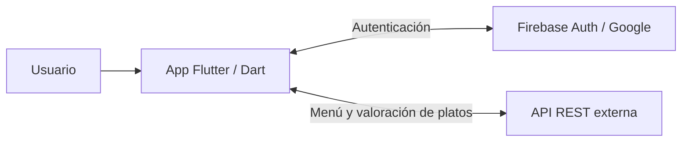
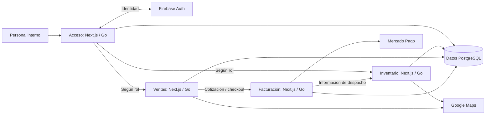
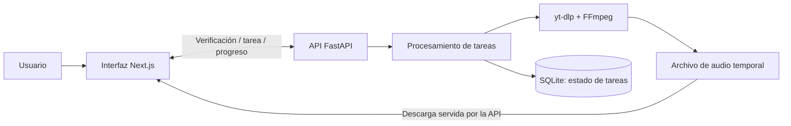

# Propuesta de diagramas para los proyectos en repositorios

Fecha de revisión: 17 de octubre de 2026.

Este documento propone los cambios para revisión conjunta. No implementa cambios en los componentes del portafolio.

## Alcance y criterio de evidencia

Se revisaron las ramas por defecto de Ruta 5 y Beat MP3 Converter (`main`), la infraestructura de ConstrUTEM (`main`) y los ocho repositorios de sus módulos (`develop`). Se consultaron manifiestos de dependencias, código de interfaces y servicios, autenticación, rutas, almacenamiento, infraestructura y workflows.

Es una revisión estática del código. No se compilaron ni ejecutaron estos proyectos externos, no se enviaron pagos ni conversiones y no se verificó su infraestructura privada. La existencia de una integración o de archivos de despliegue no demuestra que esté operativa hoy. La URL pública de Beat no pudo verificarse con la herramienta web utilizada.

Referencias de revisión comprobadas:

| Recurso | Rama | Commit |
| --- | --- | --- |
| Ruta 5 | main | `2abb32a9417de76e294df6b48b693c9fbc51846d` |
| Beat MP3 Converter | main | `3679a2a36006b085b41a69a2befc543ba222aebb` |
| ConstrUTEM / infra | main | `b55cf731230111be182f22277a7323a738b40025` |
| ConstrUTEM / backend-inventario | develop | `7ef6eec05786356be29d04de48e29e9d73ba6ae3` |

Los diagramas siguientes son propuestas de presentación basadas en el código, no certificaciones de funcionamiento en producción.

## Ruta 5

### Hallazgos

- Aplicación académica para un restobar ficticio, documentada como trabajo de Computación Móvil.
- Flutter y Dart para la aplicación. Provider y ChangeNotifier para el estado; separación en presentación, dominio y datos.
- Firebase Authentication para registro y acceso mediante correo o Google. El repositorio limita el correo al dominio institucional.
- El menú se obtiene desde una API REST externa: `GET /restaurant/v1/menu/today`.
- Las valoraciones de platos se envían mediante `POST /restaurant/v1/evaluation/dish`. Las solicitudes incorporan un token Bearer.
- SharedPreferences participa en el almacenamiento local del token. No se encontró evidencia de que el menú o las valoraciones se almacenen en Firestore en el código revisado.
- El README describe cómo generar un APK; esto no demuestra publicación en una tienda.

### Límite que afecta al diagrama

La ruta de error de valoraciones incluye una simulación de guardado local. Ese método espera y escribe mensajes, pero no persiste realmente la valoración. En una excepción puede devolverse éxito a la interfaz. Por tanto, la presentación no debe prometer guardado sin conexión ni envío garantizado.

### Diagrama propuesto

En el panel: tres bloques principales y una bifurcación hacia los dos servicios externos. Provider se puede mostrar como detalle de la aplicación, sin añadir otra etapa a las solicitudes.

- Encabezado: Arquitectura del proyecto.
- Etiqueta: Proyecto académico.
- Recorrido: Iniciar sesión → consultar menú → valorar un plato.
- Distribución: código disponible; generación de APK documentada.

### Fuentes

- [README](https://github.com/HarrySevenVader/Ruta-5-/blob/main/README.md).
- [Dependencias](https://github.com/HarrySevenVader/Ruta-5-/blob/main/pubspec.yaml).
- [Autenticación](https://github.com/HarrySevenVader/Ruta-5-/blob/main/lib/features/auth/data/repositories/firebase_auth_repository.dart).
- [Consulta del menú](https://github.com/HarrySevenVader/Ruta-5-/blob/main/lib/features/menu/data/datasources/menu_api_datasource.dart).
- [Valoraciones y simulación de guardado](https://github.com/HarrySevenVader/Ruta-5-/blob/main/lib/features/menu/data/repositories/rating_repository_impl.dart).

## ConstrUTEM

### Hallazgos

La organización contiene cuatro módulos, cada uno con frontend y backend: acceso, inventario, ventas y facturación. El repositorio `infra` los agrupa como submódulos Git y configura su ejecución conjunta.

| Área | Implementación observada |
| --- | --- |
| Frontends | Next.js, React y TypeScript |
| Backends | Go y Gin |
| Datos | Conexiones PostgreSQL; GORM en inventario, ventas y facturación |
| Acceso | Google/Firebase Auth; backend valida token y consulta rol en PostgreSQL |
| Inventario | Productos, stock, sucursales, proveedores, usuarios y despacho |
| Ventas | Clientes, selección de stock y cotizaciones |
| Facturación | Cotización, pagos mediante Mercado Pago, documentos PDF y comunicación de despacho |
| Mapas | Código para Google Maps, incluido cálculo de distancias en inventario |
| Infraestructura | Docker Compose para ejecución conjunta; workflows con Artifact Registry y GKE; manifiestos Kubernetes |

El frontend de acceso redirige según el rol, incluyendo vendedor y administrador. Ventas consulta datos de productos y stock; facturación consulta cotizaciones, comunica estados a ventas y envía información a inventario para despacho. Existen accesos directos a tablas de negocio desde varios módulos: el diagrama no debe sugerir aislamiento estricto de datos por microservicio.

### Límites que afectan al diagrama

- Hay conexiones PostgreSQL en varios servicios, pero el número físico de bases e instancias depende de variables de entorno. Un bloque agrupado representa la tecnología de datos, no una topología de despliegue confirmada.
- Los workflows y manifiestos demuestran configuración de despliegue, no disponibilidad actual del clúster.
- El endpoint de webhook de Mercado Pago revisado recibe y devuelve el cuerpo; no implementa por sí mismo conciliación completa del pago. Otras funciones consultan y actualizan estados. No conviene dibujar una automatización integral basada exclusivamente en ese webhook.
- El PDF generado por el proyecto no debe presentarse como una factura electrónica tributaria certificada sin otra evidencia.

### Diagrama propuesto

Este esquema es la referencia técnica. Para la tarjeta del portafolio se propone una versión compacta: acceso por rol, tres módulos agrupados, datos e integraciones. Los frontends y APIs se distinguen dentro de cada módulo. No se dibujarán todos los endpoints.

- Encabezado: Arquitectura modular.
- Etiqueta: Código disponible.
- Recorrido: Acceder según rol → gestionar inventario o ventas → facturar y coordinar despacho.
- Infraestructura, en una franja separada: Docker Compose · despliegue GKE configurado.

### Fuentes

- [Infraestructura y módulos](https://github.com/Construtem/infra/blob/main/docker-compose.yml).
- [Acceso y redirecciones por rol](https://github.com/Construtem/frontend-login/blob/develop/src/components/auth/loginForm.tsx).
- [Validación de identidad y rol](https://github.com/Construtem/backend-login/blob/develop/handlers/auth_handler.go).
- [Dependencias de inventario](https://github.com/Construtem/backend-inventario/blob/develop/go.mod).
- [Datos de stock consultados por ventas](https://github.com/Construtem/backend-ventas/blob/develop/api/controllers/producto_controller.go).
- [Rutas de facturación](https://github.com/Construtem/backend-facturacion/blob/develop/routes/routes.go).
- [Envío a despacho](https://github.com/Construtem/backend-facturacion/blob/develop/handlers/Enviar_datos_despacho.go).
- [Receptor del webhook](https://github.com/Construtem/backend-facturacion/blob/develop/mercadopago/webhook.go).
- [Google Maps](https://github.com/Construtem/backend-inventario/blob/develop/services/google_maps.go).
- [Workflow de despliegue](https://github.com/Construtem/backend-inventario/blob/develop/.github/workflows/CI-CD-staging.yml).

## Beat MP3 Converter

### Hallazgos

- Interfaz Next.js, React y TypeScript. El hook `useConvert` gestiona verificación, selección de calidad, conversión, progreso y descarga.
- La validación actual se centra en URLs de YouTube; no se presenta como convertidor universal de cualquier URL.
- API Python/FastAPI con verificación de video, creación de tarea, consulta de estado y descarga del resultado.
- Procesamiento mediante ThreadPoolExecutor dentro del backend. No se encontró un servicio externo de colas como Redis/Celery en esta implementación.
- yt-dlp obtiene los metadatos y el audio; FFmpeg realiza la conversión a MP3.
- SQLite guarda los registros y estados de tareas. Los archivos de audio se guardan en directorios locales de trabajo y se limpian después de servir la descarga.
- El frontend consulta el estado aproximadamente cada 800 ms durante una conversión. Es polling HTTP, no WebSocket.
- La configuración apunta a Vercel para la interfaz y Render para el backend.

### Límites que afectan al diagrama

`render.yaml` sitúa SQLite en `/tmp/jobs.db`; eso no permite prometer persistencia duradera tras reinicios del entorno. El audio tampoco debe representarse como una biblioteca de archivos permanente. No se verificó en ejecución la conversión completa ni el estado actual del backend.

### Diagrama propuesto

En el panel se agruparán procesamiento y conversión para limitar el número de bloques. SQLite y el archivo temporal se mostrarán como ramas distintas. La infraestructura aparecerá separada del flujo de conversión.

- Encabezado: Flujo de conversión.
- Etiqueta: Código disponible.
- Recorrido: Pegar URL de YouTube → verificar → elegir calidad → convertir → descargar.
- Infraestructura: Vercel / Render, configurados en el repositorio; operación actual pendiente de validación.

### Fuentes

- [Dependencias de frontend](https://github.com/HarrySevenVader/beat-mp3-converter/blob/main/front-converter/package.json).
- [Estado y consulta de progreso](https://github.com/HarrySevenVader/beat-mp3-converter/blob/main/front-converter/src/hooks/useConvert.ts).
- [Cliente HTTP y validación de URL](https://github.com/HarrySevenVader/beat-mp3-converter/blob/main/front-converter/src/services/api.ts).
- [Rutas de conversión y limpieza tras descarga](https://github.com/HarrySevenVader/beat-mp3-converter/blob/main/back-converter/app/routes/convert.py).
- [Workers](https://github.com/HarrySevenVader/beat-mp3-converter/blob/main/back-converter/app/services/worker_pool.py).
- [Conversión](https://github.com/HarrySevenVader/beat-mp3-converter/blob/main/back-converter/app/services/downloader.py).
- [Repositorio SQLite](https://github.com/HarrySevenVader/beat-mp3-converter/blob/main/back-converter/app/services/job_repository.py).
- [Configuración Render](https://github.com/HarrySevenVader/beat-mp3-converter/blob/main/render.yaml).

## Solución de implementación propuesta

### Alternativas

| Alternativa | Ventaja | Coste |
| --- | --- | --- |
| Tres paneles completamente independientes | Ajuste libre para cada proyecto | Duplicación de títulos, estados, nodos y estilos |
| Panel compartido, datos por proyecto y tres disposiciones | Coherencia, menor duplicación y control responsivo | Requiere definir qué información admite cada disposición |
| Biblioteca para grafos interactivos | Zoom, arrastre y conexiones arbitrarias | Más dependencias e interacción de la necesaria para estas tarjetas |

Se recomienda la segunda alternativa. No hace falta un motor de grafos genérico: bastan disposiciones para servicios externos, módulos y procesamiento.

### Cambios previstos, sujetos a acuerdo

1. Definir identificador de diagrama, recorrido y etiqueta de estado para cada RepositoryProject en `portfolio.ts`.
2. Reutilizar FlowIcon y FlowNode. Mantener las variantes de repositorios en `ProjectFlowDiagram.tsx`, como se hizo con los publicados, con un marco visual compartido y propiedades de estado explícitas.
3. Evitar que la elección por defecto envíe variantes desconocidas al diagrama de Gustito. La selección de variantes debe ser explícita y comprobada por TypeScript.
4. Sustituir el panel decorativo de los tres repositorios por sus diagramas. Mantener el panel de Próximamente como espacio reservado.
5. Mantener la paginación existente, los paneles montados y la reserva de altura. Comprobar también que el marco principal Publicados/Repositorios reserve la altura más alta.
6. Conservar el fondo y el barrido celeste. Usar HTML/CSS y SVG para nodos e iconos, sin canvas ni animación continua de conexiones.
7. Adaptar los diagramas a disposición vertical en móvil. Evitar reducir el texto para encajar una arquitectura extensa.
8. Reemplazar el texto introductorio que afirma que ninguno tiene sitio publicado por una descripción de la colección de código, pues Beat declara una URL de frontend en su repositorio.

### Comprobaciones posteriores a la implementación

- TypeScript, lint y build.
- Tres diagramas correctos y espacio de Próximamente conservado.
- Sin etiquetas automáticas de En producción o Sistema Online para los repositorios.
- Sin desbordamiento horizontal en móvil.
- Controles de paginación y fondo estables al alternar páginas y colecciones.
- Contenido inactivo fuera del foco y de la navegación accesible.

## Decisiones para acordar

- Aprobar los tres flujos compactos y la solución de panel compartido con disposiciones específicas.
- Para ConstrUTEM, mostrar el ecosistema completo como arquitectura del proyecto; cualquier atribución del trabajo personal debe explicarse por separado según la participación real.
- Usar Proyecto académico para Ruta 5 y Código disponible para ConstrUTEM y Beat mientras no se confirme su operación actual.
- Si se quiere mostrar En producción o una demostración activa, validar ese estado antes de añadir la etiqueta.
